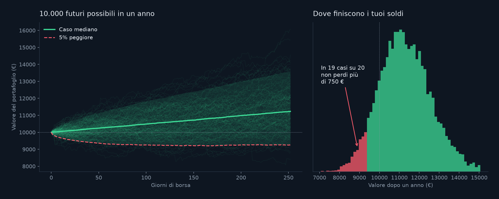

# Rischio di portafoglio con simulazione Monte Carlo

[English](README.md)

Quanto puoi perdere su 10.000 € investiti per un anno? Questo progetto risponde con una **simulazione Monte Carlo**: rigioca migliaia di anni possibili costruiti con giorni di borsa reali e legge il rischio dai risultati.



## L'idea in quattro passi

1. **Dati reali.** Dieci anni di prezzi giornalieri (2016-2025) di cinque strumenti scelti perché si comportano in modo diverso: azioni USA (SPY), Apple (AAPL), azioni europee (VGK), obbligazioni USA (AGG) e oro (GLD). Fonte: Yahoo Finance, tramite `yfinance`.
2. **Rendimenti giornalieri.** Per ogni giorno, di quanto si è mosso ogni prezzo rispetto al giorno prima.
3. **Simulazione.** Un anno simulato è fatto di 252 giorni di borsa pescati a caso, con rimpiazzo, dalla storia reale. Si pesca un giorno intero alla volta (tutti e cinque gli strumenti insieme), quindi le correlazioni e i giorni di crollo reali restano intatti. Si ripete 10.000 volte.
4. **Rischio.** Si guardano i valori finali di tutti gli anni simulati.

| Misura | Significato |
|---|---|
| **VaR 95%** | La perdita che viene superata solo nel 5% degli anni simulati ("in 19 anni su 20 non perdi più di questa cifra") |
| **Perdita media nel 5% peggiore** | Quanto va male quando si capita in quel 5% sfortunato (si chiama anche CVaR) |
| **Probabilità di perdita** | Quota di anni simulati che finiscono sotto la cifra di partenza |

## Risultati

Portafoglio di base: 40% azioni USA, 30% obbligazioni, 10% ciascuno Apple, azioni europee e oro. 10.000 anni simulati, 10.000 € investiti, seed 42:

- valore mediano dopo un anno: circa 11.230 €
- VaR 95%: 750 € (una seconda prova con un altro seed ha dato 761 €)
- perdita media nel 5% peggiore: circa 1.200 €
- probabilità di chiudere l'anno in perdita: 15,8%

La demo usa 5.000 anni simulati, quindi i numeri sono leggermente diversi. Quattro preset nella demo:

| Portafoglio | Valore mediano | Perdita in 19 anni su 20 | Perdita media nel 5% peggiore | Probabilità di perdita |
|---|---|---|---|---|
| Prudente (70% obbligazioni) | 10.546 € | 467 € | 705 € | 19,0% |
| Bilanciato | 11.252 € | 718 € | 1.132 € | 15,7% |
| Aggressivo (niente obbligazioni né oro) | 12.000 € | 1.435 € | 2.073 € | 18,6% |
| Solo Apple | 12.889 € | 1.948 € | 2.827 € | 19,0% |

La probabilità di perdere cambia poco tra i portafogli: cambia **quanto** si perde quando succede. È proprio quello che mostra il VaR e che il rendimento medio nasconde.

## Provalo

Apri `demo.html` nel browser. Muovi i cinque slider o scegli un preset: le cifre del rischio e i grafici si aggiornano. Tutto gira nella pagina, senza server e senza Python.

Ho confrontato i risultati della demo con un calcolo Python indipendente sugli stessi giorni pescati: i quattro preset coincidono esattamente.

## Eseguilo tu

```bash
pip install -r requirements.txt
python download_data.py   # scarica i prezzi in data/prices.csv
python returns.py         # rendimenti, volatilità, correlazioni
python simulate.py        # simulazione Monte Carlo e cifre del rischio
python chart.py           # docs/risultati.png
python make_demo.py       # costruisce demo.html
```

| File | Cosa fa |
|---|---|
| `download_data.py` | Scarica i prezzi |
| `returns.py` | Rendimenti giornalieri, volatilità e correlazioni dei cinque strumenti |
| `simulate.py` | La simulazione Monte Carlo e il VaR |
| `chart.py` | Il grafico dei risultati |
| `demo.template.html`, `make_demo.py` | La demo interattiva (`demo.html`) |

## Limiti

- **Il passato è stato molto buono per le azioni.** Il 2016-2025 è stato un decennio eccezionalmente forte (nella storia usata qui le azioni USA rendono in media circa il 15% l'anno e Apple circa il 29%), quindi i risultati mediani sono probabilmente ottimistici. Non vanno letti come una previsione.
- **I giorni vengono pescati in modo indipendente.** I mercati veri hanno lunghi periodi negativi (per esempio il 2008) in cui le perdite si susseguono. Pescando giorni indipendenti questi periodi sono sottostimati, quindi il rischio reale è probabilmente più alto di quello mostrato.
- **Solo cinque strumenti, senza costi né tasse**, e il portafoglio non viene mai ribilanciato durante l'anno.
- **Dieci anni di dati** contengono pochi eventi estremi.

È un progetto didattico, **non un consiglio di investimento**.
