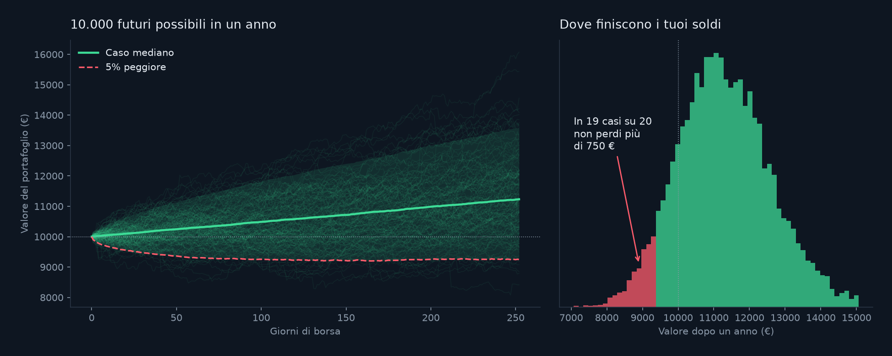

# Portfolio risk with Monte Carlo simulation

[Italiano](README.it.md)

How much can you lose on 10,000 € invested for one year? This project answers with a **Monte Carlo simulation**: it replays thousands of possible years built from real market days and reads the risk off the results.



## The idea in four steps

1. **Real data.** Ten years of daily prices (2016-2025) for five assets chosen to behave differently: US stocks (SPY), Apple (AAPL), European stocks (VGK), US bonds (AGG) and gold (GLD). Source: Yahoo Finance, through `yfinance`.
2. **Daily returns.** For each day, how much each price moved compared with the day before.
3. **Simulation.** One simulated year is 252 trading days drawn at random, with replacement, from the real history. A whole day is drawn at once (all five assets together), so correlations and real crash days are kept. Repeat 10,000 times.
4. **Risk.** Look at the final values of all simulated years.

| Measure | Meaning |
|---|---|
| **VaR 95%** | The loss that is exceeded in only 5% of simulated years ("in 19 years out of 20 you lose no more than this") |
| **Average loss in the worst 5%** | How bad it gets when you are in that unlucky 5% (also called CVaR) |
| **Probability of a loss** | Share of simulated years that end below the starting amount |

## Results

Default portfolio: 40% US stocks, 30% bonds, 10% each Apple, European stocks and gold. 10,000 simulated years, 10,000 € invested, seed 42:

- median value after one year: about 11,230 €
- VaR 95%: 750 € (a second run with another seed gave 761 €)
- average loss in the worst 5%: about 1,200 €
- probability of ending the year at a loss: 15.8%

The demo uses 5,000 simulated years, so its numbers differ slightly. Four presets in the demo:

| Portfolio | Median value | Loss in 19 years out of 20 | Average loss in the worst 5% | Probability of a loss |
|---|---|---|---|---|
| Prudent (70% bonds) | 10,546 € | 467 € | 705 € | 19.0% |
| Balanced | 11,252 € | 718 € | 1,132 € | 15.7% |
| Aggressive (no bonds, no gold) | 12,000 € | 1,435 € | 2,073 € | 18.6% |
| Apple only | 12,889 € | 1,948 € | 2,827 € | 19.0% |

Note that the probability of a loss barely changes between portfolios: what changes is **how much** you lose when you do. That is exactly what VaR shows and what the average return hides.

## Try it

Open `demo.html` in a browser. Move the five sliders or pick a preset and the risk figures and charts update. Everything runs in the page: no server, no Python.

Demo and charts are in Italian. I checked the demo's results against an independent Python calculation on the same drawn days: the four presets match exactly.

## Run it yourself

```bash
pip install -r requirements.txt
python download_data.py   # downloads prices into data/prices.csv
python returns.py         # returns, volatility, correlations
python simulate.py        # Monte Carlo simulation and risk figures
python chart.py           # docs/risultati.png
python make_demo.py       # builds demo.html
```

| File | What it does |
|---|---|
| `download_data.py` | Downloads the prices |
| `returns.py` | Daily returns, volatility and correlations of the five assets |
| `simulate.py` | The Monte Carlo simulation and VaR |
| `chart.py` | The results chart |
| `demo.template.html`, `make_demo.py` | The interactive demo (`demo.html`) |

## Limits

- **The past was very good for stocks.** 2016-2025 was an unusually strong decade for stocks (the history used here averages about 15% a year for US stocks and 29% for Apple), so the median results are probably optimistic. Do not read them as a forecast.
- **Days are drawn independently.** Real markets have long bad periods (2008, for example) where losses follow one another. Drawing days independently understates these, so the real risk is likely higher than the one shown.
- **Only five assets, no costs, no taxes**, and the portfolio is never rebalanced during the year.
- **Ten years of data** contain few extreme events.

This is a learning project, **not investment advice**.
